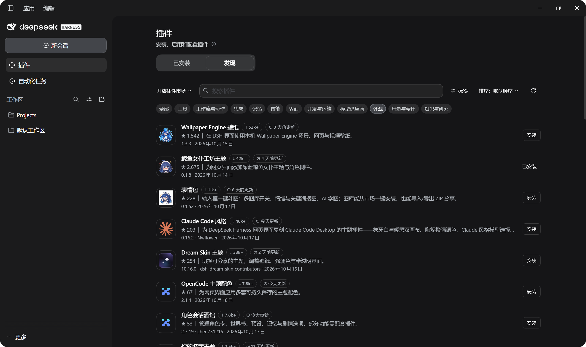

# Open Plugin Market · 开放插件市场


[](https://polang233.github.io/dsh-plugin-index/zh/)
[](https://github.com/polang233/dsh-plugin-index/actions/workflows/publish.yml)

DeepSeek Harness（DSH）的社区插件市场。数据为主、推荐为主，界面保持简洁。

**不按 star 论英雄。** 默认推荐以**最近增长快、更新勤、刚上架**为主，同时参考其他市场的验证、下载量和 star，同一作者不会霸榜。小开发者的新作品也能出现在首屏，被更多人看到。

[浏览目录](https://polang233.github.io/dsh-plugin-index/zh/) · [English](README.en.md) · [提交插件](https://github.com/polang233/dsh-plugin-index/issues/new?template=plugin.yml)



## 使用

先在 DSH **插件 → 实验性插件** 中打开 **自定义插件市场**，然后任选一种方式：

**方式一：安装插件（推荐）**。运行下面的命令，从 GitHub 安装 `dsh-open-market`。插件会自动把索引加入「发现」的索引源，只添加一次，之后你删掉了也不会再加回来。

```bash
dsh plugin --profile desktop add "git+https://github.com/polang233/dsh-plugin-index.git#main&path:/packages/dsh-open-market"
```

**方式二：手动添加**。在 **发现 → 添加索引源** 中粘贴：

```text
https://polang233.github.io/dsh-plugin-index/index.json
```

## 推荐与标签

| 标签 | 含义 |
| --- | --- |
| ✓ 第三方验证 | 被其他插件市场的人工或源码级审核收录 |
| 🔥 增长快 | 近 7 天下载量或 star 明显增长 |
| ⚡ 更新勤 | 近 30 天发版 ≥ 3 次 |
| ✦ 新上架 | 首次发布不满 30 天 |
| ◷ 最近 / 本周 / 本月 / 三个月内更新 | 收录版本的发布时间 |
| ↓ 100+ … 10万+ | npm 近 30 天下载量，共 7 档 |

排序可选 **智能推荐**、近 7 天下载增长、近 7 天新增 star、下载量、star 和随机。智能推荐以增长和活跃为主，也参考第三方验证、下载量和 star。索引每 6 小时更新一次。算法细节和数据来源见 [指标说明](docs/market-display.md)。

## 提交插件

[填写收录申请](https://github.com/polang233/dsh-plugin-index/issues/new?template=plugin.yml)，或在 [`data/sources.json`](data/sources.json) 中添加条目后提交 PR。插件需要公开源码、可安装的 npm 版本和明确的许可证，详见 [贡献指南](.github/CONTRIBUTING.md)。在 npm 包中附带自己的 Logo 会优先审核。

每次构建都会核对发布包的完整性、包名、版本和组合包声明，再用官方校验器检查索引格式。包检查不代表代码审计或安装测试。[检查记录](https://polang233.github.io/dsh-plugin-index/status.json)

## 目录结构

```text
data/       收录列表 sources.json 与发布者身份 publishers.json
scripts/    索引、指标、推荐和网站的生成脚本
packages/   dsh-open-market 插件
site/       网站样式与品牌素材
public/     构建产物，发布到 GitHub Pages
docs/       维护说明、指标说明、核查记录
test/       单元测试与浏览器测试
```

## 开发

需要 Node.js 24+ 和 pnpm 11。

```bash
pnpm install --frozen-lockfile --ignore-scripts
```

```bash
pnpm test && pnpm build && pnpm validate
```

[维护说明](docs/maintenance.zh-CN.md) · [MIT](LICENSE)

独立社区项目，与 DeepSeek 官方无隶属关系。各插件的版权和许可证归原作者所有。
